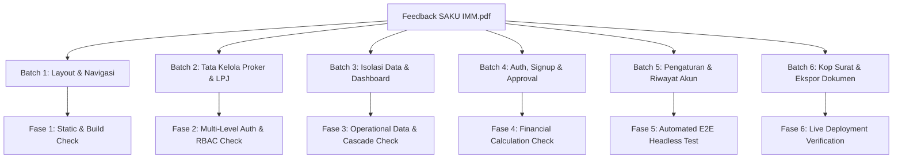

# 📋 RENCANA IMPLEMENTASI CHECKING & RE-VERIFIKASI MENYELURUH (AUDIT QUALITY ASSURANCE PLAN)
**Proyek:** SAKU IMM — Sistem Administrasi Keuangan Ikatan Mahasiswa Muhammadiyah  
**Dokumen Acuan:** `Feedback SAKU IMM.pdf` (Temuan Audit 7–11 Oktober 2026 & Daftar Bug #2)  
**ID Rencana:** QA-PLAN-SAKU-IMM-REV2026  
**Target:** 30 Butir Temuan Audit across 6 Batches  

---

## 1. TUJUAN & RUANG LINGKUP CHECKING (OBJECTIVES & SCOPE)

Rencana implementasi checking (*quality assurance & re-verification plan*) ini disusun untuk memastikan bahwa **seluruh 30 butir temuan** dari dokumen acuan `Feedback SAKU IMM.pdf` yang telah diperbaiki:
1. **Benar-benar teruji dan berfungsi optimal (*zero defect*)** di seluruh lapisan kode (*codebase*), antarmuka (*UI/UX*), dan penyimpanan lokal (*storage persistence*).
2. **Memenuhi aturan hierarki kepemimpinan 5 tingkat IMM** (DPP, DPD, PC, KORKOM, PK) serta pemisahan peran (*role-based access control*: Bendahara Umum, Tim Verifikasi Internal, Super Admin).
3. **Mencegah terjadinya regresi (*regression proof*)**, kebocoran data multi-tenant (*tenant isolation*), dan kendala tampilan seperti *white screen* atau error parsing sesi.
4. **Menghasilkan bukti empiris pengujian** yang dapat dipertanggungjawabkan secara teknis melalui pengujian otomatis (*automated E2E headless testing*) dan verifikasi dokumen cetak resmi.

---

## 2. METODOLOGI & MATRIKS VERIFIKASI 30 BUTIR TEMUAN

Proses checking dibagi ke dalam **6 Batch Verifikasi** yang mencakup 30 butir temuan:

### Matriks Pemetaan Butir Temuan ke Komponen & Metode Uji

| No | ID Temuan | Komponen Target | Deskripsi Temuan & Perbaikan | Metode Pengujian | Kriteria Lolos (Acceptance Criteria) |
| :---: | :--- | :--- | :--- | :--- | :--- |
| 1 | **MISC-01** | `MasterDataView.tsx` | Form input proker ganda di sebelah kiri tabel dihapus | DOM & Route Check | Tabel proker tampil 100% full-width; tombol `+ Input Proker Baru` mengarahkan ke form mandiri |
| 2 | **MISC-02** | `Sidebar.tsx` | Nomenklatur menu: *Daftar Program Kerja* & *Laporan Arus Kas* | Visual & Link Check | Label menu sidebar baku 100% sesuai Tanfidz IMM |
| 3 | **MISC-03** | `Sidebar.tsx`, `Header.tsx` | Responsivitas mobile & drawer hamburger toggle | Viewport Resize (<768px) | Drawer terbuka/tertutup via hamburger tanpa tumpang-tindih antarmuka |
| 4 | **MISC-04** | `Header.tsx`, `App.tsx` | Filter kalender interaktif (Bulan & Tahun aktif) | State & Event Check | Mengubah bulan/tahun di header langsung mengubah filter data periode aktif |
| 5 | **PROKER-01** | `storageService.ts` | Cascade delete: hapus proker otomatis menghapus transaksi terkait | Storage & State Check | Menghapus kartu proker otomatis menghapus seluruh transaksi dengan `programKerjaId` tersebut |
| 6 | **PROKER-02** | `MasterDataView.tsx` | Proteksi hapus & edit proker berstatus `LPJ Selesai` | Conditional UI Check | Tombol Edit & Hapus disembunyikan/diganti badge gembok terkunci saat status `Selesai` |
| 7 | **PROKER-03** | `DetailLaporanProkerView.tsx` | Penghapusan tombol *Tarik Kembali LPJ* | Security & UI Check | Tombol tarik kembali LPJ tidak ada di kode & antarmuka; status finalisasi bersifat satu arah |
| 8 | **PROKER-04** | `DetailLaporanProkerView.tsx` | Pop-up alert konfirmasi sebelum finalisasi LPJ | Modal Dialog Check | Alert muncul: *"Laporan Program Kerja '[Nama]' Tidak Bisa di Edit setelah di SUBMIT..."* |
| 9 | **PROKER-05** | `DetailLaporanProkerView.tsx` | Tombol Export Excel & Preview PDF LPJ hanya aktif jika LPJ Selesai | Authorization UI Check | Proker `Belum` selesai menampilkan info badge: *"Cetak & Export LPJ aktif setelah disubmit"* |
| 10 | **RBAC-01** | `DetailLaporanProkerView.tsx` | Role `tim_verifikasi_internal` dilarang submit LPJ / upload nota | Role Guard Check | Login sebagai verifikator internal menyembunyikan tombol submit LPJ dan form upload nota |
| 11 | **TRX-01** | `TransactionFormView.tsx` | Hapus kolom *Aksi Audit* & tombol JSON di modul transaksi kas | Form Layout Check | Kolom tabel `<th>Aksi Audit</th>` dan tombol JSON modal dihapus permanen |
| 12 | **TENANT-01**| `App.tsx` | Isolasi data multi-tenant: proker & transaksi murni per level aktif | Multi-Level Check | User PK hanya melihat proker/transaksi miliknya; data tidak bercampur dengan PC/DPD/DPP |
| 13 | **DASH-01** | `DashboardView.tsx` | Filter dropdown level pimpinan di Beranda (*Semua Pimpinan*, *DPD*, dll) | Interactive Filter Check | Memilih filter level memperbarui nominal 3 kartu kas, 2 chart, dan tabel proker secara real-time |
| 14 | **DASH-02** | `DashboardView.tsx` | Judul banner: *Ikhtisar Keuangan ([Level] IMM) \| View Only* | Copywriting Check | Judul banner dan label chart (*Pengeluaran Per Bidang*, *Pengeluaran Per Kategori*) presisi 100% |
| 15 | **LOGIN-01** | `LoginPage.tsx` | Form registrasi akun: standardisasi label struktural IMM | Sign Up Form Check | Label memuat: *Level Organisasi Pimpinan \**, *Jenis Akun \**, *Nama Level Pimpinan IMM \**, dll. |
| 16 | **LOGIN-02** | `LoginPage.tsx` | Blokir login akun organisasi yang berstatus pending/belum disetujui | Auth Guard Check | Akun pending ditolak masuk dengan pesan: *"Akun Anda sedang menunggu persetujuan / verifikasi..."* |
| 17 | **LOGIN-03** | `LoginPage.tsx` | Pembersihan slider login (hapus centang, tampilkan 3 Nilai Utama) | Carousel UI Check | Slider bersih tanpa bullet check; copyright `Copyright © DPP IMM 2026`; logo BCA Syariah rapi |
| 18 | **APPRV-01** | `OrganizationVerificationView.tsx` | Otoritas approval murni downstream (pimpinan hanya menyetujui bawahan) | Hierarchy Order Check | Pimpinan Cabang (PC) hanya melihat permintaan dari KORKOM & PK; tidak melihat DPD / DPP |
| 19 | **SETT-01** | `SettingsView.tsx`, `App.tsx` | Persistensi form edit profil pengguna ke LocalStorage | Persistence Check | Edit nama/email/instansi tetap tersimpan setelah browser di-refresh |
| 20 | **SETT-02** | `SettingsView.tsx` | Hapus kartu redundant *"Status Verifikasi Akun Organisasi Anda"* | UI Cleanliness Check | Kartu verifikasi redundant tidak muncul di profil seluruh level akun |
| 21 | **SETT-03** | `SettingsView.tsx` | Log aktivitas difilter murni untuk aksi level akun aktif | Audit Filter Check | User PK hanya melihat jejak log aksi miliknya sendiri (`log.organisasiLevel === userLevel`) |
| 22 | **SETT-04** | `SettingsView.tsx` | Judul tab *Riwayat Akun (Log Activity)* tanpa istilah teknis JSONB | Copywriting Check | Nomenklatur user-friendly tanpa teks *JSONB Snapshot Persisten* |
| 23 | **RPT-01** | `PrintableCashFlowReportModal.tsx` | Kop surat: Lambang resmi IMM Tanfidz Wikipedia (SVG) di kiri | Vector SVG Check | Logo `imm-logo-official.svg` tampil tajam, presisi, dan sesuai regulasi Muktamar IMM |
| 24 | **RPT-02** | `PrintableCashFlowReportModal.tsx` | Kop surat: Logo resmi SAKU IMM di sisi kanan menggantikan stempel teks | Image Asset Check | Logo `logosakuimmnew.png` terpasang proporsional di sisi kanan kop |
| 25 | **RPT-03** | `PrintableCashFlowReportModal.tsx` | Garis pembatas ganda Tanfidz IMM (garis tebal maroon + garis tipis) | CSS Border Check | Garis ganda membatasi kop dan isi dokumen sesuai format Surat Keputusan Resmi IMM |
| 26 | **RPT-04** | `PrintableProkerReportModal.tsx` | Penyelarasan format kop & footer LPJ Proker dengan Arus Kas | Document Layout Check | Format kop, identitas institusi, dan kolom tanda tangan bendahara seragam di kedua laporan |
| 27 | **RPT-05** | `PrintableCashFlowReportModal.tsx` | Metrik laporan arus kas dihitung dinamis dari data transaksi riil | Math & Data Check | Saldo, total putaran, dan pengeluaran terbesar dihitung dari `transaksiList` aktual |
| 28 | **RPT-06** | `PrintableCashFlowReportModal.tsx` | Tombol *Unduh Dokumen PDF* langsung tanpa dialog printer browser | html2pdf Engine Check | Klik tombol langsung men-download berkas PDF A4 tanpa memicu window.print() |
| 29 | **RPT-07** | `ReportsView.tsx` | Harmonisasi tab Arus Kas on-screen (3 kartu saldo, tombol download) | Layout Matching Check | Tampilan on-screen 100% cocok dengan mockup acuan *img-000.png* |
| 30 | **STAB-01** | `ErrorBoundary.tsx`, `sw.js` | Stabilitas kompilasi, ErrorBoundary, resiliensi sesi, network-first SW | Runtime Stability Check | Bebas white screen, 0 uncaught exception, build passed 100% |

---

## 3. TAHAPAN EKSEKUSI CHECKING (EXECUTION PHASES)

Checking akan dieksekusi secara terstruktur melalui 6 fase berikut:

### 🔹 Fase 1: Static Code, TypeScript Types & Compilation Audit
- **Tugas:** Menjalankan type-checking TypeScript dan production build.
- **Perintah:** `npm run build`
- **Output:** Verifikasi 0 TypeScript errors dan bundle size optimal.

### 🔹 Fase 2: Multi-Tier Authentication & RBAC Verification
- **Tugas:** Menguji login pada 5 level pimpinan IMM (DPP, DPD, PC, KORKOM, PK) dan 3 role (Bendahara Umum, Tim Verifikasi, Super Admin).
- **Verifikasi Khusus:**
  - Akun belum diverifikasi (`status: 'pending'`) wajib diblokir saat login.
  - Role `tim_verifikasi_internal` wajib berstatus read-only (tidak ada tombol submit LPJ / tambah transaksi).
  - Verifikasi pendaftaran downstream: Pimpinan hanya dapat menyetujui bawahan.

### 🔹 Fase 3: Data Integrity, Cascade Delete & Proker Lock Verification
- **Tugas:** Menguji alur hidup data program kerja dan transaksi.
- **Verifikasi Khusus:**
  - Penambahan program kerja via `InputProkerView.tsx` (22 bidang resmi, tanggal baku).
  - Penghapusan proker memicu penghapusan cascade seluruh transaksi terkait.
  - Proker berstatus `LPJ Selesai` tidak menampilkan tombol Edit maupun Delete.
  - Tombol *Tarik Kembali LPJ* dipastikan tidak ada di antarmuka maupun event handler.
  - Pop-up konfirmasi muncul sebelum LPJ difinalisasi.

### 🔹 Fase 4: Financial Calculation & Reporting Document Verification
- **Tugas:** Menguji keakuratan angka matematis kas dan output cetak dokumen.
- **Verifikasi Khusus:**
  - Perhitungan Saldo = Pemasukan - Pengeluaran dari array transaksi aktual.
  - Modal pratinjau dokumen arus kas dan LPJ memuat kop resmi: Lambang IMM (kiri), Logo SAKU IMM (kanan), garis pembatas ganda Tanfidz.
  - Tombol *Unduh Dokumen PDF* mengunduh file `.pdf` secara langsung (`html2pdf.js`).
  - Tombol *Export Excel* mengunduh file `.xlsx` dengan sheet terformat rapi.

### 🔹 Fase 5: Automated End-to-End Headless Testing Script
- **Tugas:** Menjalankan script uji otomatis terprogram (`scripts/run_comprehensive_audit_check.mjs`) menggunakan Chrome DevTools Protocol (CDP) pada aplikasi yang sedang berjalan.
- **Cakupan Uji Otomatis:**
  1. Test Fresh Visit & Landing Page.
  2. Test Auth Kredensial 5 Level.
  3. Test Guard Akun Pending.
  4. Test Proker CRUD & Lock Badge.
  5. Test Cascade Delete Integrity.
  6. Test Clean Transaction Form.
  7. Test Cash Flow Metrics Math.
  8. Test Print Modal Tanfidz Letterhead.
  9. Test Downstream Approval Isolation.
  10. Test Settings Profile Persistence & ErrorBoundary Recovery.

### 🔹 Fase 6: Final Reporting & Live Deployment Verification
- **Tugas:**
  - Mencatat seluruh temuan hasil pengujian ke dalam laporan akhir.
  - Melakukan validasi final terhadap domain publik `https://sakuimm.vercel.app`.
  - Memastikan berkas PDF laporan resmi `LAPORAN_AUDIT_DAN_PERBAIKAN_SAKU_IMM.pdf` tetap sinkron dan valid.

---

## 4. STANDAR KELULUSAN (DEFINITION OF DONE)

Rangkaian checking dinyatakan **SELESAI & LULUS 100%** apabila:
1. Seluruh 30 butir temuan berstatus **PASS** pada automated E2E test.
2. Tidak ada error/exception yang tidak tertangani di browser console (`0 uncaught errors`).
3. Build produksi `npm run build` berjalan mulus tanpa error (`exit code: 0`).
4. Aplikasi live di `https://sakuimm.vercel.app` bebas dari gejala white screen dan responsif di desktop maupun mobile.
